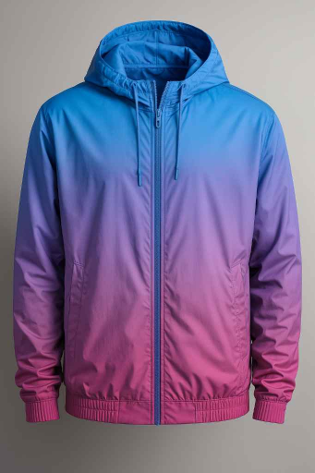

# 1-headers-헤더

# This is an H1

## This is an H2

# This is an H1

## This is an H2

### This is an H3

#### This is an H4

##### This is an H5

###### This is an H6

---

---

---

---

---

---

---

---

---

Oh my my my oh my my my
You got me high so fast <br>
네 전부를 함께하고 싶어
Oh my my my oh my my my

You got me fly so fast <br>
이제 조금은 나 알겠어

_This will also be italic_

**This will also be bold**

~~This is canceled~~

_You **can** ~~combine~~ them_

As Grace Hopper said:

> I’ve always been more interested in the future than in the past.  
> This is a first blockquote.
>
> > This is a second blockquote.
> >
> > > This is a third blockquote.

> # this is h1!
>
> - list
>   `textbox`

- 머리
  - 코
    - 입

* 머리
  - 코
    - 입
      - 입

- 머리
- 코
- 입

1. 머리
2. 다리
3. 뚝배기
4. 팔 <!-- 5번을 썻는데도 4번으로 표시된다. -->

---

1. 리스트 1번
   1. 리스트 1-1번
2. 리스트 2번
3. 리스트 3번
   1. 리스트 3-1번 <!-- 리스트 안 리스트를 사용하려면 tab과 함꼐 숫자 1번 서부터 -->
   2. 리스트 3-2번

---

1. 머리
   - 머리카락
   - 뚝배기
     - 털
2. 다리
   - 다리털
   - 발가락
     1. 허벅지

---

- 특수문자 출력안됨

* 특수문자 출력안됨

\* 특수문자 출력

\- 특수문자 출력

---

\*literal asterisks\*

\#hash mark\#

\[squre brackets\]

---


[  ](링크URL)

[](https://unity3d.com/kr)

---

[Google](http://www.google.com "구글")

[Naver](http://www.naver.com "네이버")

[Github](http://www.github.com "깃허브")

---

구글 www.google.com

네이버 <www.naver.com>

My mail <inpa.dev@gmail.com>

---

[링크는 젤다의전설 주인공 이름](http://zeldahagoshipda.com)

---

[1. Headers 헤더](#1-headers-헤더)

[2. Emphasis 강조](#2-emphasis-강조)

[3. Blockquotes 인용](#3-blockquotes-인용)

---

```javascript
function test() {
  console.log("look ma’, no spaces");
}
```

---

- [x] this is a complete item
- [ ] this is an incomplete item

---

- [x] @mentions, #refs, [links](), **formatting**, and <del>tags</del> supported

---

테이블 생성

| 헤더1 | 헤더2 | 헤더3 | 헤더4 |
| ----- | ----- | ----- | ----- |
| 셀1   | 셀2   | 셀3   | 셀4   |
| 셀5   | 셀6   | 셀7   | 셀8   |
| 셀9   | 셀10  | 셀11  | 셀12  |

---

테이블 정렬

| 헤더1 | 헤더2  | 헤더3 |
| :---- | :----: | ----: |
| Left  | Center | Right |
| 1     |   2    |     3 |
| 4     |   5    |     6 |
| 7     |   8    |     9 |

---

---

---

As Grace Hopper said:

> I’ve always been more interested in the future than in the past.  
> This is a first blockquote.
>
> > This is a second blockquote.
> >
> > > This is a third blockquote.

- 머리
  - 코
    - 입

* 머리
  - 코
    - 입
      - 입

- 머리
- 코
- 입

1. 머리
2. 다리
3. 뚝배기
4. 팔 <!-- 5번을 썻는데도 4번으로 표시된다. -->

---

1. 리스트 1번
   1. 리스트 1-1번
2. 리스트 2번
3. 리스트 3번
   - 리스트 3-1번 <!-- 리스트 안 리스트를 사용하려면 tab과 함꼐 숫자 1번 서부터 -->
   - 리스트 3-2번

   ***

4. 머리
   - 머리카락
   - 뚝배기
     - 털
5. 다리
   - 다리털
   - 발가락
     1. 허벅지

---

\* 특수문자 출력

\- 특수문자 출력

\*literal asterisks\*

\#hash mark\#

\[squre brackets\]

---




[  ](링크URL)

[](https://unity3d.com/kr)

[1. Headers 헤더](#1-headers-헤더)

[2. Emphasis 강조](#2-emphasis-강조)

[3. Blockquotes 인용](#3-blockquotes-인용)

```javascript
function test() {
  console.log("look ma’, no spaces");
}
```

---

- [x] this is a complete item
- [ ] this is an incomplete item

- [x] @mentions, #refs, [links](), **formatting**, and <del>tags</del> supported

- [x] @mentions, #refs, [links](), **formatting**, and ~~tags~~ supported

테이블 생성

| 헤더1 | 헤더2 | 헤더3 | 헤더4 |
| ----- | ----- | ----- | ----- |
| 셀1   | 셀2   | 셀3   | 셀4   |
| 셀5   | 셀6   | 셀7   | 셀8   |
| 셀9   | 셀10  | 셀11  | 셀12  |

이블 정렬

| 헤더1 | 헤더2  | 헤더3 |
| :---- | :----: | ----: |
| Left  | Center | Right |
| 1     |   2    |     3 |
| 4     |   5    |     6 |
| 7     |   8    |     9 |
